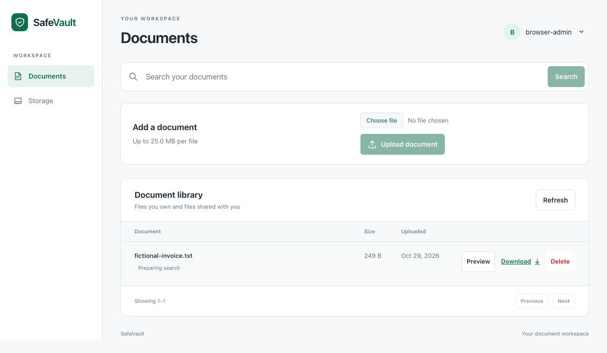
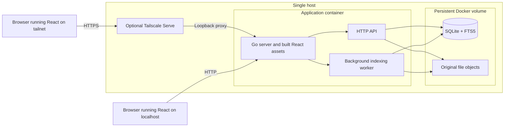

# SafeVault

A private, self-hosted document workspace for small teams.

SafeVault grew from a practical need to keep a family's business records in one place, where authorized people can upload, find, preview and retrieve documents from different devices. Original files and search data stay on that host, with optional private access through Tailscale.

It is a working development and portfolio project built with Go, React, TypeScript, SQLite and Docker. Production backup and restoration still need validation before it holds sensitive business records.



## Features

- **Documents:** upload with real transfer progress, download original bytes, and delete with confirmation. Owners and administrators can delete; the browser library works on desktop and mobile.
- **Accounts and permissions:** Argon2id passwords, revocable server-side sessions, document ownership and explicit `read`, `write` and `manage` grants. Account and grant management are available through the authenticated API; a permission-management screen is still planned.
- **Search:** filenames and metadata for authorized documents, plus extracted text from supported TXT, PDF and DOCX files. Indexing runs after upload, so content results may take time to appear.
- **Previews:** read-only text, table or generated image views for supported formats. Originals remain available through authenticated downloads.
- **Storage:** SQLite metadata and original objects in one persistent Docker volume, with administrator-only storage totals and optional Mac disk measurements.
- **Private access:** optional HTTPS via Tailscale Serve while the Docker port stays on localhost. Every user still signs in to SafeVault.

### File-format support

| Format                 | Upload | Preview                                                    | Content search                |
| ---------------------- | ------ | ---------------------------------------------------------- | ----------------------------- |
| TXT                    | Yes    | Text, shortened for large files                            | Yes, within extraction limits |
| PDF with text layer    | Yes    | Rendered pages                                             | Yes, from extractable text    |
| Image-only scanned PDF | Yes    | Rendered pages                                             | No OCR                        |
| DOCX                   | Yes    | Extracted main-body text; original layout is not preserved | Yes, extracted text           |
| XLSX                   | Yes    | Read-only worksheet table                                  | No                            |
| CSV                    | Yes    | Read-only table                                            | No                            |
| JSON                   | Yes    | Formatted text                                             | No                            |
| PNG, JPEG, WebP        | Yes    | Decoded and re-encoded image                               | No                            |

All uploads are subject to the configured size limit. Preview and text extraction have additional format and resource limits; a stored file that cannot be previewed remains downloadable. PDF rendering and extraction require Linux and Poppler, included in the Docker image. Filename and metadata search work independently of content indexing. See [preview limits](docs/previews.md), [extraction limits](docs/extraction.md) and [search behavior](docs/search.md).

## Quick start

**Prerequisites:** Git, Docker with Compose v2, and an available local port `8080`. Start Docker Desktop first on macOS. Initial image builds require Internet access; Go and Node.js are built inside the image.

For a fresh installation:

```sh
git clone https://github.com/pinkhit/vault.git
cd vault
cp .env.example .env
docker compose config --quiet
docker compose build
docker compose run --rm --no-deps --entrypoint /app/create-admin app -username admin
docker compose up -d --wait
```

The bootstrap command securely prompts for a password of at least 15 characters. It works only before the first account exists and while the server is stopped. There is no default password or public registration. Open **http://localhost:8080**, sign in and try `tests/fixtures/fictional-invoice.txt`.

For later starts, use `docker compose up --build -d --wait`; do not repeat bootstrap. `docker compose down` stops the application and preserves its named volume. **Do not run `docker compose down -v`: it deletes the volume and its documents.** Keep an existing `.env` and the `safevault` Compose project name when upgrading. Deployments created before the rename need the [storage migration notes](docs/ui-polish.md#deployment-identifiers) before switching project names.

Private access requires an exact HTTPS origin, Secure cookies and native [Tailscale Serve setup](docs/private-access.md#checkpoint-2--host-side-serve-setup). The optional [Mac storage collector](docs/storage-analytics.md#macos-host-collector) supplies physical disk measurements; document totals work without it. Configuration defaults are in [.env.example](.env.example).

## Architecture

One Go process serves the built React application and API and runs a background indexing worker. SQLite handles accounts, sessions, permissions, metadata, audit events, search indexes and durable indexing jobs. SQLite and the original file objects share one persistent Docker volume.



Docker publishes only `127.0.0.1:8080`. In private mode, Tailscale Serve terminates HTTPS and proxies to that local port; it does not supply application identity or permissions. The single-host design keeps deployment small and allows SQLite to coordinate metadata, grants, audit events and indexing state without a separate database service. The host and its administrator remain trusted.

| Path                                                 | Responsibility                                                   |
| ---------------------------------------------------- | ---------------------------------------------------------------- |
| `backend/cmd/`                                       | Server, first-administrator bootstrap and optional Mac collector |
| `backend/internal/api`, `auth`, `authorization`      | HTTP boundary, accounts, sessions and document access            |
| `backend/internal/documents`, `storage`, `database`  | Metadata, original objects, recovery and embedded SQL migrations |
| `backend/internal/indexing`, `extraction`, `preview` | Durable text jobs and bounded document rendering                 |
| `frontend/src`, `frontend/e2e`                       | React UI, API client, unit and browser tests                     |
| `tests/`, `docs/`, `.github/workflows/`              | Synthetic fixtures, integration tests, design records and CI     |

The application uses Go 1.26 with the standard HTTP server, React 19 and TypeScript 7, the pure-Go `modernc.org/sqlite` driver with FTS5, Linux Poppler for PDF text and rendering, and Docker Compose for packaging. Vitest, Playwright, Go tests and GitHub Actions cover the main behavior. Versions are pinned in [go.mod](backend/go.mod), [package.json](frontend/package.json) and the [Dockerfile](Dockerfile). See the [architecture guide](docs/architecture.md) and [storage decision](docs/decisions/001-core-storage.md).

## Engineering Highlights

**Filesystem and database consistency.** Uploads stream into private staging, hash and sync the complete file, then publish a metadata row in SQLite. Since the filesystem and database cannot commit atomically, startup verifies referenced objects and reconciles incomplete or unreferenced files. [Crash behavior](docs/architecture.md#upload-and-crash-consistency).

**Secure document access.** Sessions are stored server-side with expiry and revocation, and authenticated writes require a CSRF token. Document reads, writes and grants use current database permissions; listing and search filter unauthorized records before pagination or snippets are returned. [Permission rules](docs/authentication.md#permission-rules).

**Durable asynchronous indexing.** A worker extracts bounded TXT, PDF and DOCX text outside the upload request. SQLite keeps job status and retries across restarts; publication checks the source checksum so stale work cannot replace results for a changed document. [Indexing lifecycle](docs/indexing.md).

**Safe previews.** Untrusted document contents are parsed with size and resource bounds, then returned as inert text, table cells or generated PNGs. The app does not embed uploaded originals as executable content in its browser origin. [Preview boundary](docs/previews.md#browser-content-boundary).

**Tests and deployment.** Backend tests cover authorization failures, integrity errors and recovery; browser tests cover desktop/mobile file flows and session behavior. A disposable Compose project tests persistence and restart behavior; the intended deployment remains one host and one application container. [Verification record](docs/ui-polish.md#verification--october-29-2026).

## Security and limitations

SafeVault is **not approved for sensitive production records**. Backup and restoration, deployment recovery and operational monitoring still need validation. A local Docker volume is not an off-device backup.

- Tailscale limits network access but does not replace SafeVault login or document authorization. The host OS, Docker network and TLS proxy are trusted parts of the deployment.
- SHA-256 checks detect byte changes; they do not encrypt files or prove who created them. There is no application-level encryption at rest or malware scanning.
- Deletion has no trash or undo and is not secure erasure. Folder organization, version history, MFA, account recovery and total storage quotas are absent.
- Office previews simplify layout; XLSX formulas are displayed as inert text, not executed. OCR, spreadsheet content indexing and AI retrieval are not implemented.
- Startup and download integrity checks read full files. Large-library performance, hardware power-loss durability and production backup/restore have not been established.

The [threat model](docs/threat-model.md), [adversarial security review](docs/security-review-milestone-2.md) and [private-access limits](docs/private-access.md) describe the boundaries in detail. Automated checks reduce risk; they are not a complete security audit.

## Testing and verification

The repository includes Go unit/integration tests, `go vet`, race-detector runs, frontend unit tests, Playwright browser flows, an isolated Docker restart/persistence smoke test and a [GitHub Actions workflow](.github/workflows/ci.yml). The smoke test uses synthetic data in its own temporary Compose project and volume; it does not alter the regular library.

The [local verification record](docs/ui-polish.md#verification--october-29-2026) reports, for **October 29, 2026**, passing Go vet/race checks with 80.5% combined statement coverage, 49 frontend tests, four Chrome flows, a Compose smoke test and a Linux ARM64 build. Those are historical local results; a hosted CI result for this README change has not been verified.

```sh
cd backend && go vet ./... && go test -race ./...
cd ../frontend && npm ci && npm run format:check && npm test && npm run build
cd .. && ./tests/compose-smoke.sh
```

Browser tests also require Playwright with Chromium or a compatible Chrome, Go on PATH and a built frontend. See [native development and browser setup](docs/architecture.md#native-development) and [CI](.github/workflows/ci.yml).

## Roadmap

- Folder organization, file moves and drag-and-drop.
- Permission-management UI, recoverable deletion and version history.
- Tested production backup/restore, monitoring and quotas.
- OCR, expanded spreadsheet search and optional local AI retrieval.

## Documentation and license

- [Architecture and data flow](docs/architecture.md) · [Storage decision](docs/decisions/001-core-storage.md)
- [Accounts, permissions and API](docs/authentication.md) · [Search](docs/search.md) · [Previews](docs/previews.md)
- [Storage analytics](docs/storage-analytics.md) · [Private HTTPS](docs/private-access.md)
- [Security review](docs/security-review-milestone-2.md) · [Verification record](docs/ui-polish.md)

Licensed under [Apache 2.0](LICENSE).
