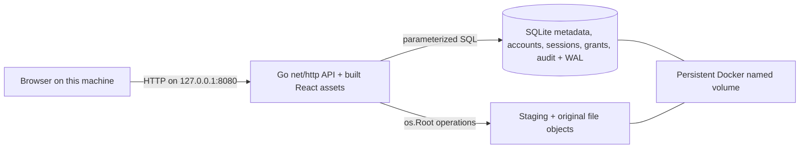

# FamilyVault architecture

Implemented: one Go server, embedded SQLite migrations, local file objects, a React browser with search, indexing indicators and read-only previews, password accounts, server-managed sessions, explicit document permissions, audit events, durable background TXT/PDF/DOCX indexing and a permission-aware FTS5 search API. Administrator storage analytics uses SQLite metadata and a cached filesystem provider. DOCX uses the same bounded text reader for indexing and preview; [format limits](docx.md) apply. [XLSX worksheet previews](xlsx.md) share the Office ZIP/XML reader. AI and remote access remain planned.

Previews reuse document read authorization and confined, checksum-verified storage. The [preview boundary](previews.md) returns escaped text/tables or generated PNGs; PDFs are rasterized by bounded Poppler subprocesses. A shared `pdfutil` runner keeps extraction and preview process limits consistent. No inline original, public object directory, new schema or separate service is introduced.

Compose publishes only `127.0.0.1:8080`; the container listener must use `0.0.0.0` inside its network namespace. Native development binds loopback directly. The server rejects foreign Host and Origin headers and cross-site browser requests. Docker's networking and the local host remain trusted. Do not connect other containers or expose this development service remotely.

During frontend development, Vite binds `127.0.0.1:5173` and proxies `/api` to `127.0.0.1:8080`. The built application and API use one origin. No CORS allowlist is needed.

## Code boundaries

- `cmd/server`: configuration, resource lifecycle, startup reconciliation, signals and HTTP timeouts.
- `internal/api`: HTTP validation, JSON errors, pagination, local-browser boundary, concurrency limit.
- `cmd/create-admin`: offline initial account creation under the data-directory lock; no default credentials.
- `internal/auth`: Argon2id passwords, login throttling, persistent sessions, expiry/revocation and account changes.
- `internal/authorization`: explicit document read/write/manage checks; no folder inheritance yet.
- `internal/audit`: structured security/document events sharing mutation transactions.
- `internal/documents`: filenames, metadata queries, checksum comparison, upload coordination and permission-filtered search. See the [search contract](search.md).
- `internal/indexing`: persistent jobs, one bounded worker, retries/recovery and transactional passage publication. See [indexing lifecycle](indexing.md).
- `internal/extraction`: bounded TXT passages and Linux Poppler subprocesses. See [extraction limits](extraction.md).
- `internal/storage`: confined file operations, staging, syncing, verification and startup cleanup.
- `internal/database`: SQLite settings and embedded, ordered, transactional migrations.
- `internal/config`: environment validation and safe bind defaults.

SQLite uses one pooled connection, foreign keys, a busy timeout, WAL and FULL synchronous mode. A data-directory file lock excludes a second server before migration/recovery. This deliberately targets a single host and process. Read/write scalability can be measured and revisited later.

## Authentication and authorization

Every sensitive route requires a database-backed session. Only health/login and static assets are public. Login requires exact same-origin Origin validation; authenticated writes also require a session-bound CSRF token. Account status and role are loaded on each request. Document SQL checks enabled users, administrator authority, ownership or explicit grants before returning metadata/opening files. Mutations recheck rights in their transaction, with an atomic audit event. Raw session tokens live only in HttpOnly cookies; SQLite holds token hashes and expiry/activity timestamps.

Administrator account/audit reads recheck current administrator authority in the same transaction as the metadata query. Audit details identify permission recipients and before/after rights or account role/status changes. Migration 003 preserves old events with empty details and rejects ordinary SQL history updates/deletes; this does not make the database tamper-evident against its owner. Public static files use a separate `os.Root` to confine symlink resolution to the configured web directory.

Read the [authentication/API guide](authentication.md) and [ADR 002](decisions/002-authentication-and-permissions.md) for the permission table, bootstrap and local HTTP exception. Sessions are revocable and have both absolute and idle expiry. No external identity, AI, mail or network service is introduced.

## Upload and crash consistency

1. Authenticate the session, validate its CSRF token, then validate one multipart `file`, its raw filename, body bounds and optional checksum header.
2. Generate a random 128-bit lowercase hexadecimal object ID. The name never becomes a filesystem path.
3. Stream at most the configured maximum plus one byte into `staging/<id>` (0600), computing SHA-256. Reject empty files, read errors, missing closing boundaries and extra parts.
4. Sync and close the complete staging file. Compare the client checksum when supplied.
5. Hard-link the file into `objects/<id>` without overwriting an existing object, then sync the object directory. Both directories are on the same local volume.
6. Recheck that the uploader is enabled and insert complete metadata, ownership, indexing job and audit event in one SQLite transaction. Only authorized metadata rows are listed or downloadable; listing filters before pagination.
7. Remove the staging name. Cleanup failures are logged; startup retries cleanup.

There is **no atomic transaction spanning SQLite and the filesystem**. Before serving, recovery verifies every referenced object's size and SHA-256, removes staging entries, and removes unreferenced objects. A crash before metadata insertion leaves an invisible orphan. A crash after insertion leaves a complete record, possibly with a redundant staging link. A failed/ambiguous INSERT never triggers immediate object deletion: it could have committed. Recovery uses database state to decide safely.

Missing/corrupt referenced objects stop startup; metadata is retained for investigation. Unexpected names in storage directories also stop recovery. Do not modify files in the data volume manually. Recovery hashes all stored bytes and can become slow for a large library. Downloads also verify the entire object before sending it; this is intentional for the small development repository and costs an extra sequential read. File contents are immutable through the API.

Deletion uses the reverse ordering: a SQL DELETE checks the enabled owner or administrator, cascades grants/jobs/passages/search entries and records its audit event in one transaction, then storage unlinks the object and syncs the directory. Grants confer no delete authority. Unlink is never attempted after a failed or ambiguous commit. A crash or cleanup failure leaves an inaccessible orphan for the same startup reconciliation; no new queue or schema is required. This is logical deletion with best-effort immediate file removal, not secure erasure or undo. See the [permission rules](authentication.md#permission-rules).

A process crash is covered by automated tests. Power-loss durability depends on the host filesystem, Docker volume implementation, storage device and its handling of sync requests. This milestone does not establish production durability or a backup guarantee.

## Deployment and portability

The multi-stage image builds the frontend and a CGO-free Go binary, then runs as UID/GID 10001. A named volume holds **both** the database and objects at `/data`. The root filesystem is read-only, Linux capabilities are dropped, and no privileged mounts are used. The default image build targets the host architecture; the dependency supports Linux AMD64 and ARM64 without a C compiler.

The Go process runs one indexing worker alongside HTTP handling. PDF extraction uses a resource-limited Poppler child process; extraction holds no database transaction. Derived text stays in private SQLite storage. No Ollama, cloud service or external CDN is involved at runtime. Initial dependency/image downloads require Internet access. Go, React, SQLite and npm dependency versions are recorded in manifests and lockfiles; base images use version tags rather than immutable digests, so image rebuilds can receive upstream changes.

[Storage analytics](storage-analytics.md) keeps logical document totals separate from process-visible filesystem capacity. It authorizes administrators in SQLite before grouping metadata and again before audited delivery. Capacity is sampled from a confined directory descriptor outside the database transaction, cached for 30 seconds and reported as unavailable on failure. Docker Desktop values are labelled as container/VM filesystem values, never physical Mac free space.

The storage dashboard now consumes a versioned, fresh numeric snapshot from a native macOS collector through a read-only directory mount. The collector measures the filesystem containing Docker.raw, and the UI separates host used/reclaimable/free space from Docker limits and logical documents. The original/SQLite named volume and their I/O path are unchanged. See [host setup](storage-analytics.md) and [measured layout tradeoffs](storage-performance.md).
