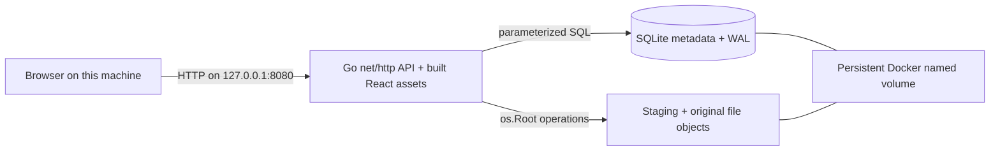

# Milestone 1 architecture

Implemented: one Go process, embedded SQLite migrations, local file objects, and a React browser. Authentication, permissions, extraction, AI and remote access are planned only.

Compose publishes only `127.0.0.1:8080`; the container listener must use `0.0.0.0` inside its network namespace. Native development binds loopback directly. The server rejects foreign Host and Origin headers and cross-site browser requests. Docker's networking and the local host remain trusted. Do not connect other containers or proxy this unauthenticated service remotely.

During frontend development, Vite binds `127.0.0.1:5173` and proxies `/api` to `127.0.0.1:8080`. The built application and API use one origin. No CORS allowlist is needed.

## Code boundaries

- `cmd/server`: configuration, resource lifecycle, startup reconciliation, signals and HTTP timeouts.
- `internal/api`: HTTP validation, JSON errors, pagination, local-browser boundary, concurrency limit.
- `internal/documents`: filenames, metadata queries, checksum comparison, upload coordination.
- `internal/storage`: confined file operations, staging, syncing, verification and startup cleanup.
- `internal/database`: SQLite settings and embedded, ordered, transactional migrations.
- `internal/config`: environment validation and safe bind defaults.

SQLite uses one pooled connection, foreign keys, a busy timeout, WAL and FULL synchronous mode. A data-directory file lock excludes a second server before migration/recovery. This deliberately targets a single host and process. Read/write scalability can be measured and revisited later.

## Upload and crash consistency

1. Validate one multipart `file`, its raw filename, body bounds and optional checksum header.
2. Generate a random 128-bit lowercase hexadecimal object ID. The name never becomes a filesystem path.
3. Stream at most the configured maximum plus one byte into `staging/<id>` (0600), computing SHA-256. Reject empty files, read errors, missing closing boundaries and extra parts.
4. Sync and close the complete staging file. Compare the client checksum when supplied.
5. Hard-link the file into `objects/<id>` without overwriting an existing object, then sync the object directory. Both directories are on the same local volume.
6. Insert complete metadata using parameterized SQL. Only metadata rows are listed or downloadable. A single INSERT is an atomic SQLite transaction.
7. Remove the staging name. Cleanup failures are logged; startup retries cleanup.

There is **no atomic transaction spanning SQLite and the filesystem**. Before serving, recovery verifies every referenced object's size and SHA-256, removes staging entries, and removes unreferenced objects. A crash before metadata insertion leaves an invisible orphan. A crash after insertion leaves a complete record, possibly with a redundant staging link. A failed/ambiguous INSERT never triggers immediate object deletion: it could have committed. Recovery uses database state to decide safely.

Missing/corrupt referenced objects stop startup; metadata is retained for investigation. Unexpected names in storage directories also stop recovery. Do not modify files in the data volume manually. Recovery hashes all stored bytes and can become slow for a large library. Downloads also verify the entire object before sending it; this is intentional for the small development repository and costs an extra sequential read. File contents are immutable through the API.

A process crash is covered by automated tests. Power-loss durability depends on the host filesystem, Docker volume implementation, storage device and its handling of sync requests. This milestone does not establish production durability or a backup guarantee.

## Deployment and portability

The multi-stage image builds the frontend and a CGO-free Go binary, then runs as UID/GID 10001. A named volume holds **both** the database and objects at `/data`. The root filesystem is read-only, Linux capabilities are dropped, and no privileged mounts are used. The default image build targets the host architecture; the dependency supports Linux AMD64 and ARM64 without a C compiler.

No Ollama, worker, cloud service, or external CDN is involved at runtime. Initial dependency/image downloads require Internet access. Go, React, SQLite and npm dependency versions are recorded in manifests and lockfiles; base images use version tags rather than immutable digests, so image rebuilds can receive upstream changes.
